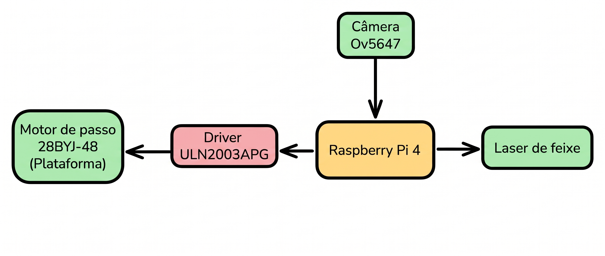
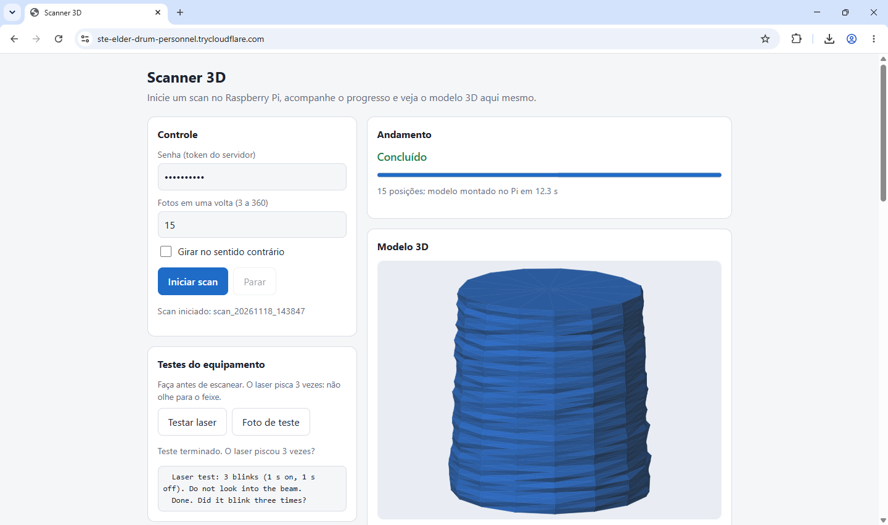
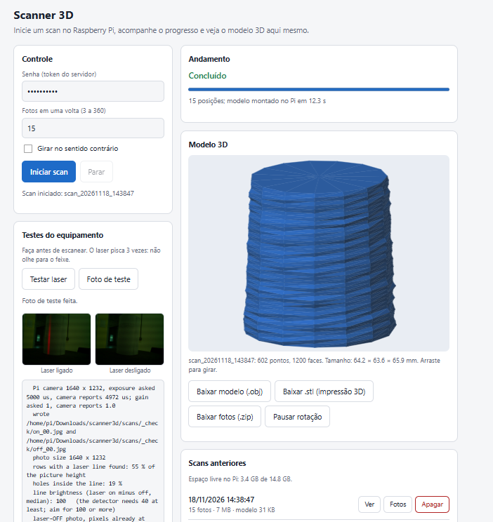
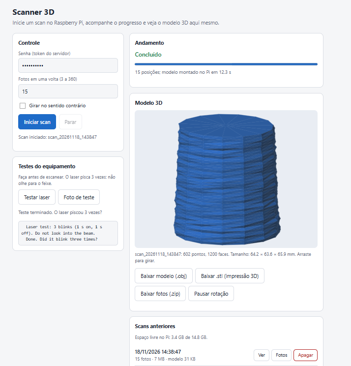
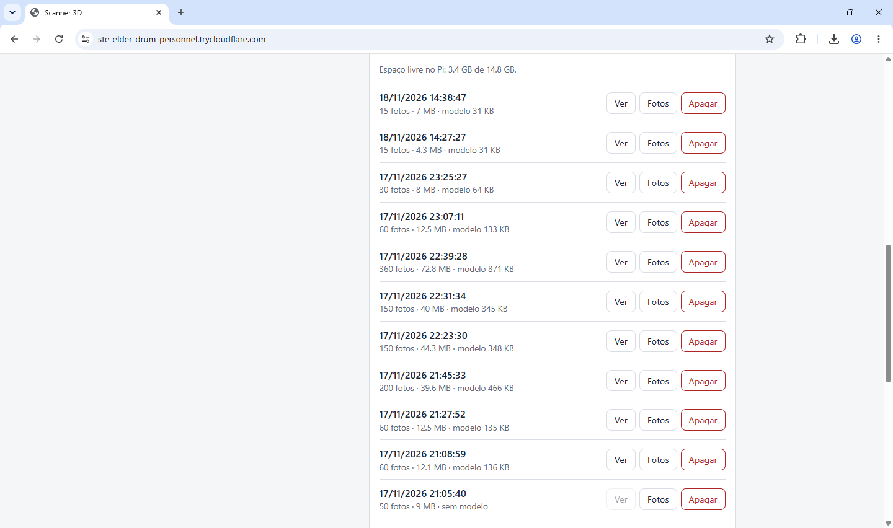
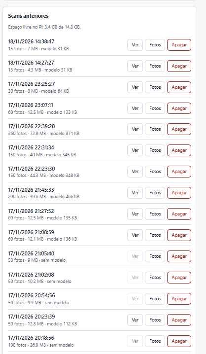

# EEN251 - Microcontroladores e Sistemas Embarcados
---

# Projeto Scanner 3D

Desenvolvimento de um scanner 3D com microcontroladores para digitalização de objetos físicos.

---

# T2: Scanner

## Diagrama de blocos


## Hardware
* **Controlador:** Raspberry Pi 4 (gerenciamento de captura, processamento de imagem e servidor web)
* **Câmera:** Câmera Ov5647 (`picamera2`, resolução padrão `1640x1232`)
* **Laser:** Laser de feixe chaveado por transistor NPN no `GPIO17` para alternância entre quadros `ON` e `OFF`
* **Plataforma Giratória:** Motor de passo `28BYJ-48` + Driver `ULN2003APG` (`GPIO5`, `GPIO6`, `GPIO13`, `GPIO19`) ou driver `STEP/DIR` (`A4988` / `DRV8825`)

## Fluxo
1. **Calibração (`calibrate.py` / `plane_map.py`)** → Mede a escala em pixels/mm, o eixo de rotação e a perspectiva da câmera usando cilindros de referência, gerando `scanner_config.py` ou `camera_map.json`
2. **Captura Automatizada (`capture.py`)** → Aciona o laser, captura um par de fotos (`on` e `off`) por ângulo e avança o motor de passo ao longo de uma volta completa (360°)
3. **Detecção Sub-pixel (`detect_line.py`)** → Subtrai a imagem `OFF` da `ON` para cancelar a iluminação ambiente, encontra o centroide da linha do laser com precisão sub-pixel e converte pixels em coordenadas `(raio, altura)` em milímetros
4. **Limpeza e Reconstrução (`cleanup.py` & `mesh.py`)** → Remove reflexos falsos, interpola sombras ou falhas e gera a malha 3D fechada em `.obj` (e `.stl` via `export_stl.py`)

## Demonstração
[Vídeo de demonstração do Scanner 3D](https://files.catbox.moe/27y6yo.mp4)

---

# T3: Interface Web e Controle Remoto

## Arquitetura de Comunicação
```
PC / Celular --- "iniciar, N fotos" ---> Raspberry Pi 4 (pi_server.py -> capture.py)
PC / Celular <-- "progresso em tempo" -- Raspberry Pi 4 (atualização em tempo real)
PC / Celular <-- "malha 3D gerada" ----- Raspberry Pi 4 (scan_folder.py -> .obj / .stl)
```

## Funcionalidades
* **Controle Remoto (`pi_server.py` & `scanner_page.html`)** → Operação completa pelo navegador via rede local ou acesso externo HTTPS com **Cloudflare Tunnel** (`cloudflared`), protegida por token de autenticação, além de cliente de linha de comando (`pc_client.py`)
* **Testes e Diagnóstico Prévio** → Acionamento remoto do laser (3 piscadas) e captura de par `ON/OFF` de teste com visualização das imagens e relatório automático de exposição e detecção de linha
* **Visualização e Exportação 3D** → Renderização interativa da malha reconstruída diretamente no navegador e download dos arquivos em `.obj`, `.stl` (pronto para impressão 3D) e `.zip` com as fotos capturadas
* **Gerenciamento de Histórico** → Monitoramento do espaço livre no cartão do Raspberry Pi e listagem dos escaneamentos anteriores com opções para visualizar, baixar fotos ou apagar registros

## Telas da Interface

### Painel Principal e Visualizador 3D


### Diagnóstico de Iluminação e Exposição (Foto de Teste)


### Visão Geral dos Módulos da Página


### Histórico de Escaneamentos e Armazenamento no Pi



---

## Execução
Para instruções detalhadas de instalação, montagem de circuito, calibração e simulação no PC, consulte o **[GUIA.md](https://github.com/bielzonho/Projeto-microcontroladores-scanner-3d/blob/main/GUIA.md)**.

```bash
# Iniciar servidor web no Raspberry Pi (T3)
python3 pi_server.py --token SEUTOKENLONGO

# Expor acesso externo via Cloudflare Tunnel (T3)
cloudflared tunnel --url http://localhost:8000

# Ou executar captura e reconstrução diretamente via terminal (T2)
python3 capture.py --out photos --platform uln2003
python3 scan_folder.py photos --map camera_map.json
```

---
# Integrantes:
Joaquim Anderlini Alves da Cunha - 22.00536-6

Gabriel Giardino Sprotte - 23.00964-0

Gabriel Fernandes Sabino - 23.01062-2

Guilherme Gonsales de Sá - 23.00882-2

Thiago Espigado Miras - 22.01836-0
